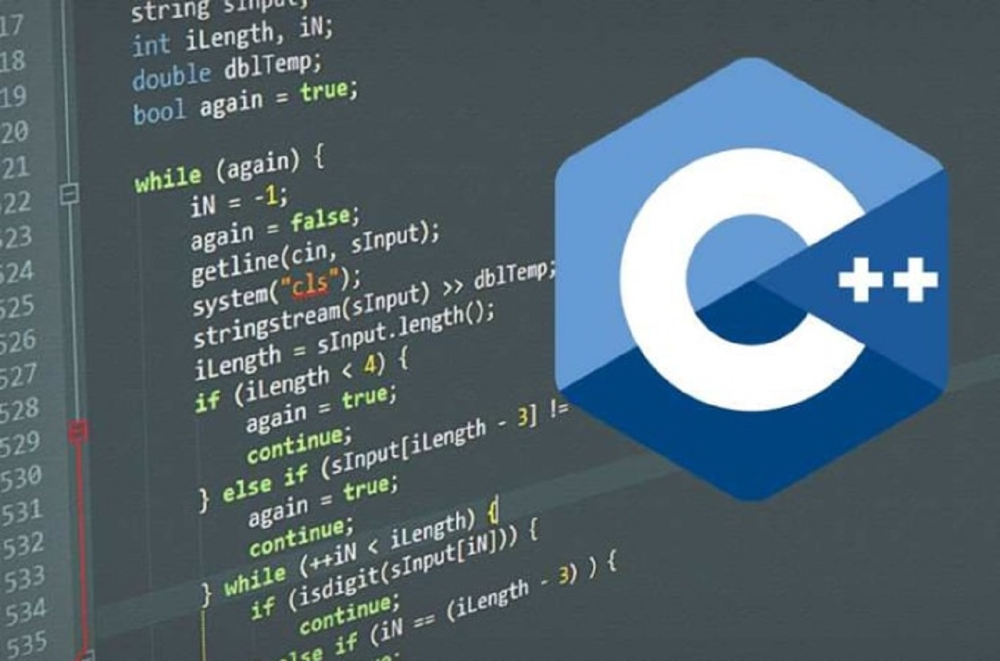

# C++ Projects

A collection of C++ mini projects, written in Code::Blocks with the MinGW compiler as console applications (no graphics). Suitable for school or college mini-project use.

## Projects

### Employee Management System
[`employee-management-system/`](employee-management-system)

A console application for managing employee records, built entirely around file handling — every record is stored in and read back from a file. Demonstrates storing, editing, searching, and deleting data on disk.

Features:
1. Build the employee table
2. List the employee table
3. Insert a new entry
4. Delete an entry
5. Edit an entry
6. Search a record
7. Sort the table

### Tic Tac Toe Game
[`tic-tac-toe-game/`](tic-tac-toe-game)

A two-player console Tic Tac Toe game built around 2D arrays for storing player input and displaying results. See [Wikipedia](https://en.wikipedia.org/wiki/Tic-tac-toe) if you're unfamiliar with the rules.

Features:
1. Two players play against each other
2. Console-based game interface
3. Input validation, with re-prompting on invalid input
4. Win, loss, and draw messages
5. Screen cleared on every move

## License

This repository is licensed under the [GNU General Public License v3.0](LICENSE).
